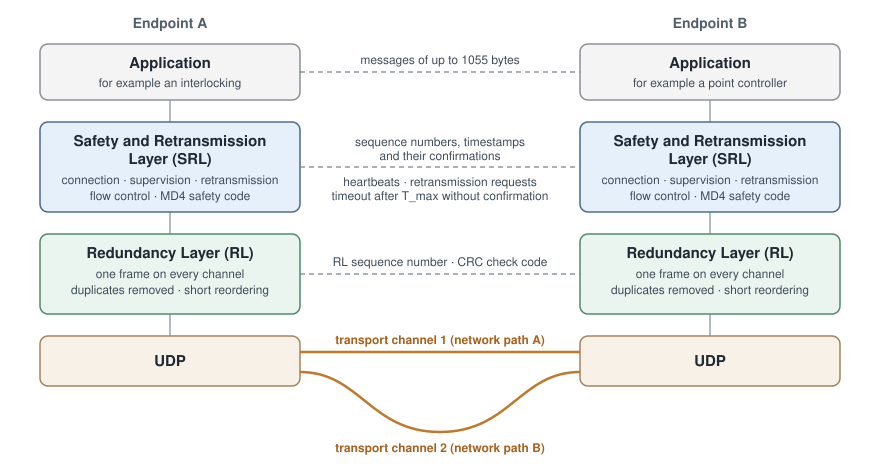

# RaSTA-Rust

An independent Rust implementation of the Rail Safe Transport Application
(RaSTA) protocol, designed around a deterministic protocol core and explicit
transport adapters.

## What is RaSTA?

RaSTA is a protocol for safety-related communication in railway signalling. It
connects, for example, an interlocking with the controllers of its field
elements (points, signals, level crossings), or a traffic-management system with
an interlocking, over ordinary IP networks. It is used as the transport for
EULYNX interfaces.

An ordinary network can lose, repeat, reorder, delay, or corrupt messages, and
deliver messages meant for someone else. Railway signalling must detect all of
that. EN 50159 lists these threats for communication in transmission systems,
and RaSTA counters them with sequence numbers, timestamps with timeliness
supervision, a safety code over every message, and fixed endpoint
identifiers. It also adds what plain UDP lacks for this purpose: connections,
retransmission of lost messages, flow control, and redundant network paths.

## How the protocol is layered



- **Safety and Retransmission Layer (SRL).** Two endpoints with fixed
  identifiers set up a connection. The endpoint with the lower identifier is
  the client: it sends the connection request, the server answers, and the
  client completes the handshake with a heartbeat. These are protocol roles
  only, not functions in the railway system. Every message carries a
  sequence number, a timestamp, and the confirmation of the peer's latest
  sequence number and timestamp. From those, each side measures the
  round-trip delay and supervises that the peer is alive and timely: a
  connection is closed when confirmations become older than `T_max`. Idle
  endpoints send heartbeats. Lost messages are retransmitted on request. A
  safety code (MD4 with configurable initial values) detects corruption; it is
  not a cryptographic protection.
- **Redundancy Layer (RL).** Each SRL message is sent on every configured
  transport channel, typically two independent network paths. The receiver
  delivers the first copy, discards duplicates, and briefly holds frames that
  arrive out of order (`T_seq`). A check code (one of several CRC profiles,
  or none) protects each frame.

The [glossary](docs/glossary.md) explains all terms and abbreviations.

## Status

This project is at an early, experimental stage. It is **not certified**, and
it does not yet claim conformance with DIN EN 50159 or any RaSTA specification.
The implementation is based on documented observations of publicly available
MIT-licensed implementations. Those observations are useful for
interoperability work, but they are not a substitute for the normative
specification.

RaSTA detects transmission errors but does not authenticate messages. On
networks that are not physically protected, run it over a separate security
layer; see the [threat model](SECURITY.md#threat-model).

The alpha provides bounded SRL and RL codecs, configurable MD4 and RL
check-code profiles, deterministic SRL and RL state machines, adaptive timing,
retransmission, duplicate suppression, bounded reordering, deterministic fault
simulation, and one/two-path UDP adapters. `StackEngine` composes these layers
without platform I/O. This is an interoperability implementation based on
documented observations, not a conformance or safety claim.

Known issues of other RaSTA implementations that affect interoperability are
listed in [interoperability](docs/interoperability.md).

## Design goals

- Preserve a credible path toward a future SIL 4 assessment.
- Keep the protocol engine deterministic and independent of sockets and clocks.
- Use UDP only in a separate RL transport adapter; do not replace RaSTA
  behaviour with TCP guarantees.
- Avoid unbounded allocation and panics on untrusted wire input.
- Trace code and tests to either normative requirements or clearly labelled
  implementation observations.

## Quick start

Requires Rust 1.83 or newer. Development commands use the compiler pinned in
`rust-toolchain.toml`; CI also checks the minimum supported version.

```sh
cargo test --all-targets --all-features
cargo clippy --all-targets --all-features -- -D warnings
cargo check --no-default-features
cargo fmt --all -- --check
cargo run --example custom_payload
cargo run --example udp_two_node
```

## Using the crate

```toml
[dependencies]
rasta-rust = "0.1"
```

The crate has no third-party dependencies. The [`std`](https://doc.rust-lang.org/std/)
feature is enabled by default and contains UDP and simulation adapters. For
the allocation-free `no_std` protocol core alone, use
`rasta-rust = { version = "0.1", default-features = false }`.

`StackEngine` is the composed SRL and RL stack for exactly one connection;
use one engine per connection. The host feeds it three kinds
of input — application commands (`step_connection`), received datagrams
(`receive_datagram`), and the current time (`poll`) — and executes the actions
it returns: datagrams to transmit on a channel, connection state changes, and
received application data (`pop_received`). The engine itself never reads a
clock or touches the network, so the host's event loop, threaded or
asynchronous, decides how I/O and time are provided. Time is given in
wrapping milliseconds; a host whose clock is coarser than 1 ms declares its
granularity with `ConnectionConfig::with_timer_granularity`.
`examples/udp_two_node.rs` shows such a host loop over two UDP paths.

The host reads its transport only while `can_receive_datagram` returns true;
otherwise datagrams wait in the transport, for example the socket buffer.
Received PDUs wait in a 20-entry receive queue until SR has room, so a slow
application delays delivery instead of losing messages. Keep at least three
send-buffer entries free (`send_usage`): with fewer, SR processes no received
PDU, not even confirmations, and the connection times out. Both rules follow
the SBB reference.

Like the reference implementations, the stack reports diagnostics: SR error
counters and `T_rtd`/`T_alive` distributions (`StackAction::ConnectionDiagnostics`)
after each diagnostic window and when the connection closes, and per-channel
RL diagnostics (`StackAction::RedundancyDiagnostics`) after each diagnosis
window. `ConnectionConfig` and `RedundancyConfig` take the window sizes.

Closing an SR connection also closes and resets its RL channel. A local
closure transmits the disconnection request before closing the channel.
After both endpoints have closed, they can reuse their existing `StackEngine`
instances by issuing `ConnectionEvent::Open` again.
When the peer closes the connection, the state change carries no disconnect
reason: as in the SBB reference, the reason in the peer's disconnection
request is not reported. Sent disconnection requests always carry detailed
reason zero.

An application message is 1 to 1055 bytes; the stack does not fragment
larger ones. One Data message can carry several application messages
(packetization), up to `N_maxPacket`. Both endpoints must configure the same
value; the default is one (`ConnectionConfig::with_max_packet`). Send several
messages together with `ConnectionEvent::SendPacked`; received messages are
always returned one at a time by `pop_received`.

### Memory placement

For small task stacks, use `StackEngine::step_connection_into`,
`receive_datagram_into`, and `poll_into`. Allocate a `StackWorkspace` and
`StackActions` once in caller-controlled storage and reuse them. The engine,
workspace, and actions all have const constructors for static placement. A
workspace can be shared sequentially between connections. Each operation clears
the actions; on a returned error it leaves the engine unchanged and exposes no
partial actions. Consume the actions before the next call reuses the storage.

This path keeps the transaction candidate and intermediate SR/RL effect batches
out of per-call stack frames, and avoids nested full engine/buffer clones.
It still needs fixed RAM for the engine, workspace, and output. The methods
returning `StackActions` are convenience APIs with large stack requirements,
as do standalone `ConnectionEngine::step` and `RedundancyEngine::step`.
See `examples/custom_payload.rs` for workspace reuse.

CI runs an optimized regression with a host thread stack of 64 KiB on Linux
and macOS, and 128 KiB on Windows. Windows needs additional stack space for
its runtime, including Rust's 20 KiB stack-overflow exception reserve and
Windows' stack allocation granularity. Persistent storage is allocated before
the test thread starts. The same paths run on every platform: maximum defer
flush (11 PDUs, 22 outgoing acknowledgements), maximum-size data send,
retransmission rebuilding, and timer expiry. These host budgets verify those
paths in CI; compiler, target, optimization, and interrupt stack requirements
still determine the deployment budget.

### Receive errors

A CRC-valid RL frame containing an invalid SR PDU (including invalid MD4 or an
oversized application-data field) emits `StackAction::DiscardedSrMessage`.
This includes a disconnection request with an unknown reason code (outside
0 through 8). It does not close the connection or refresh its timer; if the
peer stops sending accepted messages, the existing timeout closes the connection.
An authentic Data message whose field is malformed or holds more than
`N_maxPacket` application messages closes the connection instead.
RL consumes its sequence and preserves other valid deliveries in the batch;
the frame cannot stay in the defer queue and block inactivity detection.
Malformed RL frames still return errors without changing state. UDP input from
unconfigured peers is skipped, with at most 32 discarded datagrams per call so
the caller can keep servicing timers during noise.

## Documentation

- [Glossary](docs/glossary.md): terms and abbreviations.
- [Architecture](docs/architecture.md): component boundaries and resource
  limits.
- [Architecture decisions](docs/adr/): why the design is as it is.
- [State-machine status](docs/state-machine-status.md): implemented
  transitions and what still awaits normative review.
- [Observations](docs/requirements/observations.md),
  [reference provenance](docs/provenance.md), and
  [differential testing](docs/differential-testing.md): the evidence behind the
  wire behaviour. Read these before changing it.
- [Interoperability](docs/interoperability.md): known issues of other RaSTA
  implementations.
- [Trying it out](docs/trying-it-out.md): run nodes by hand, against EULYNX
  Live, and over a lossy network.
- [Release notes](docs/releases/) and the [changelog](CHANGELOG.md).
- [Dependencies](docs/dependencies.md) and
  [open questions](docs/open-questions.md).

## Licensing

RaSTA-Rust is licensed under either the Apache License, Version 2.0 or the MIT
license, at your option. Test values taken from the MIT-licensed reference
implementations are listed, with their licences, in
[THIRD_PARTY_NOTICES.md](THIRD_PARTY_NOTICES.md).
